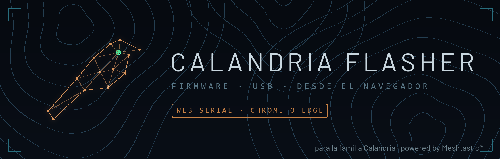
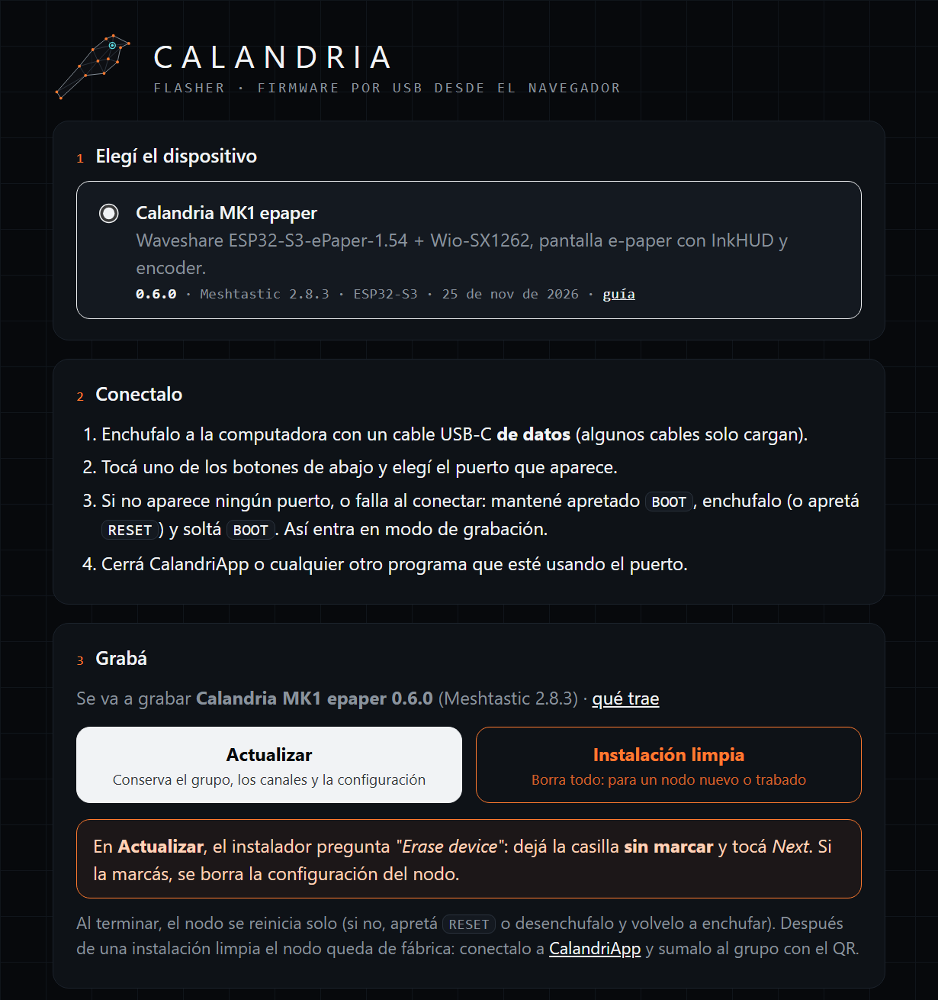
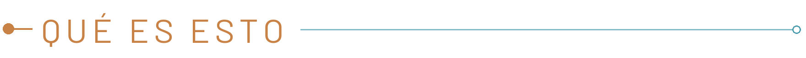

<p align="center"></p>

**Grabá o actualizá el firmware de los dispositivos Calandria desde el navegador, por USB, sin instalar
nada. Es la forma más simple de tener tu nodo al día, estés donde estés.**

Abrilo en **Chrome o Edge** en una computadora | *powered by Meshtastic®*

[](https://proto-hommer.github.io/calandria-flasher/)
[](https://github.com/proto-hommer/calandria-mk1-epaper/releases/latest)

<p align="center">
  
</p>
<p align="center"><i>Elegís el dispositivo, lo enchufás y tocás Actualizar o Instalación limpia.</i></p>

* * *

<p></p>

La familia Calandria son nodos [Meshtastic](https://meshtastic.org) propios: hoy el
[Calandria MK1 epaper](https://github.com/proto-hommer/calandria-mk1-epaper), y después vienen otros.
Se usan con [CalandriApp](https://github.com/proto-hommer/calandriapp).

Este flasher es una página web que habla con el nodo por el cable USB, con Web Serial, y le graba el
**último firmware publicado** en GitHub. No hace falta Python, PlatformIO ni drivers: enchufás, elegís y
grabás. Cuando sale un firmware nuevo, en menos de una hora aparece en la página.

<p></p>

1. Abrí **https://proto-hommer.github.io/calandria-flasher/** en Chrome o Edge, en una computadora.
   Firefox y Safari no tienen Web Serial, y en el celular no es confiable.
2. Elegí el dispositivo y enchufalo con un cable USB-C **de datos** (algunos cables solo cargan).
3. Tocá uno de los dos botones y elegí el puerto.
4. Cerrá CalandriApp u otro programa que esté usando el puerto.

<p></p>

Graba solo el firmware nuevo y **conserva todo lo demás**: el grupo, los canales, el nombre y la lista de
nodos. Cuando el instalador pregunte *"Erase device"*, dejá la casilla **sin marcar** y tocá *Next*. Si
la marcás, se borra la configuración.

<p></p>

Borra toda la memoria y graba la imagen completa. Es para un nodo nuevo o uno trabado. El nodo queda de
fábrica: conectalo a CalandriApp y sumalo al grupo con el QR.

<p></p>

Mantené apretado **BOOT**, enchufalo (o apretá **RESET**) y soltá BOOT. Así entra en modo de grabación
y el puerto aparece. Al terminar, si no se reinicia solo, apretá RESET o desenchufalo y volvelo a
enchufar.

<p></p>

| Dispositivo | Chip | Firmware |
|---|---|---|
| **Calandria MK1 epaper**: Waveshare ESP32-S3-ePaper-1.54 + Wio-SX1262, e-paper con InkHUD y encoder | ESP32-S3 | [proto-hommer/calandria-mk1-epaper](https://github.com/proto-hommer/calandria-mk1-epaper) |

<p></p>

- La página usa [ESP Web Tools](https://esphome.github.io/esp-web-tools/), la misma librería que usan
  ESPHome y otros proyectos para grabar ESP32 desde el navegador.
- `devices.json` lista los dispositivos de la familia: el repo de cada firmware, el chip y dónde va cada
  parte en la memoria.
- Una GitHub Action (`.github/workflows/pages.yml`) corre `scripts/build_site.py` cada hora, al cambiar
  algo en `main`, o a mano desde Actions → *Publicar el flasher*. Toma el release que GitHub marca como
  **Latest** en cada repo, arma los manifiestos y publica todo en GitHub Pages. Los `.bin` se copian al
  sitio porque el navegador no puede bajarlos directo de los releases (GitHub no los sirve con CORS).
- Antes de publicar, verifica que la app del `.bin` sea idéntica, byte a byte, a la que trae el
  `.factory.bin`: si un release viene mal armado, no se publica.
- **Actualizar** graba el `.bin` en la partición `app0` (`0x10000`) y repone el selector de arranque
  (`otadata`, `0xE000`) igual que en la imagen de fábrica. Así el nodo arranca la versión nueva aunque
  antes se haya actualizado por Bluetooth (OTA) desde la otra ranura. La configuración (LittleFS) no se
  toca.
- **Instalación limpia** borra toda la flash y graba el `.factory.bin` en `0`.

<p></p>

Se suma una entrada a `devices.json`:

| Campo | Qué es |
|---|---|
| `repo` | El repo del firmware. Sus releases tienen que traer un `.bin` (la app) y un `.factory.bin` (la imagen completa). |
| `asset_prefix`, `exclude` | Con qué empiezan sus archivos, y qué palabras descartan otros (`headless`, `littlefs`). |
| `chip` | `ESP32-S3`, `ESP32`, `ESP32-C3`… |
| `app_offset`, `otadata_offset`, `otadata_size` | Salen de la tabla de particiones del dispositivo. |

<p></p>

```
python3 scripts/build_site.py
python3 -m http.server -d _site
```

Y abrí http://localhost:8000: Web Serial también anda en `localhost`. El banner y los títulos de este
README salen de `tools/readme_art.py`, con la misma estética que CalandriApp y el MK1.

* * *

<p></p>

- **Licencia:** GPL-3.0, como el resto de la familia Calandria.
- **[ESP Web Tools](https://github.com/esphome/esp-web-tools)** (Apache-2.0), de la Open Home Foundation:
  la librería que graba desde el navegador. Se carga desde unpkg en una versión fija.
- **Barlow** (SIL Open Font License), de Jeremy Tribby: la tipografía del banner y los títulos.
- **powered by Meshtastic®.** Meshtastic® es una marca registrada de Meshtastic LLC. Los componentes de
  software de Meshtastic se publican bajo distintas licencias; ver su GitHub para más detalles. Calandria
  es un proyecto independiente: no es oficial ni está patrocinado ni respaldado por el proyecto Meshtastic.
- **Sin garantía:** grabás bajo tu propio riesgo. Ante la duda, **Actualizar** no borra nada que no sea el
  firmware.
